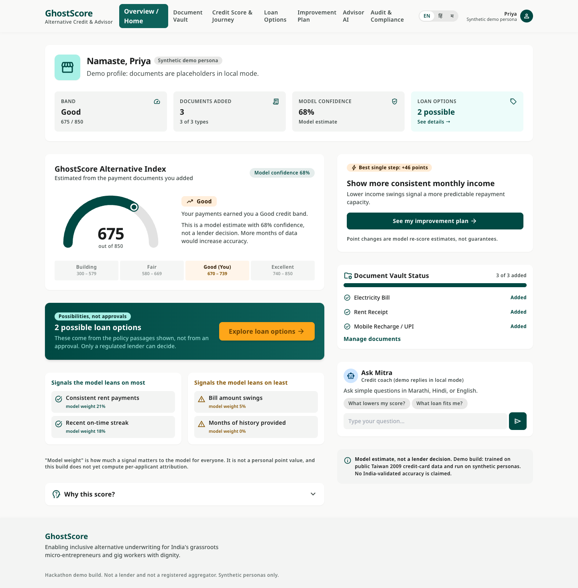
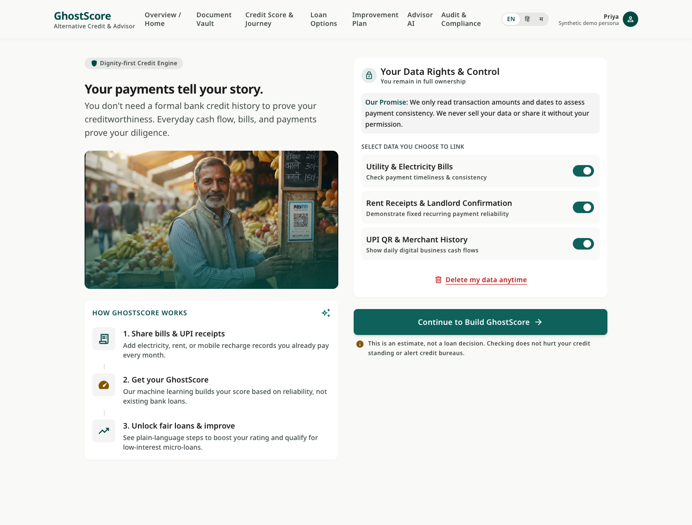
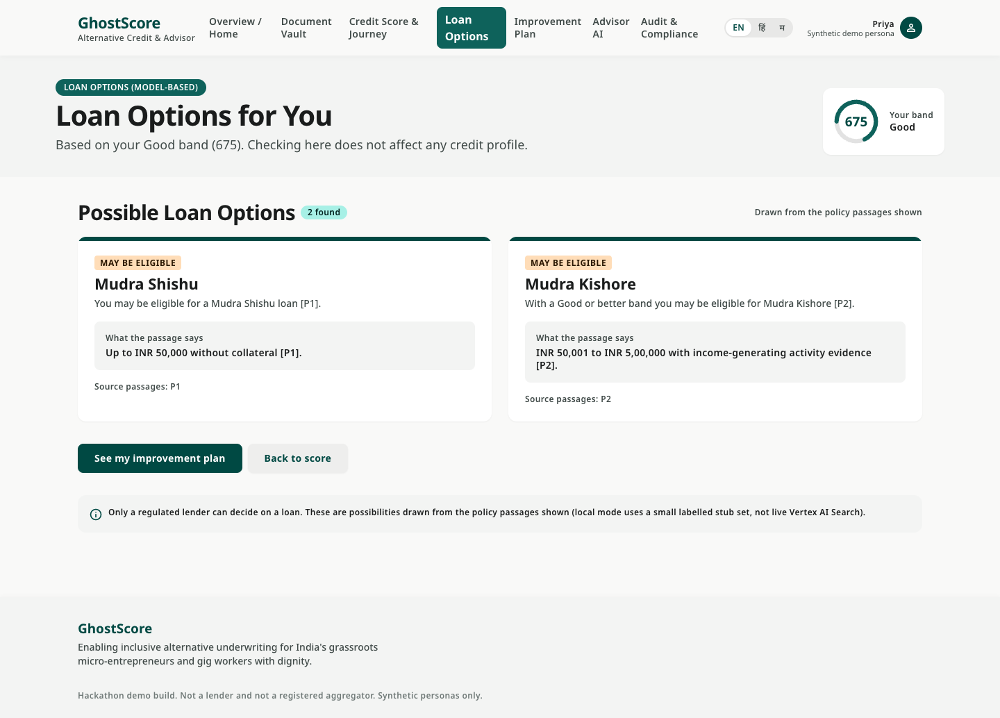
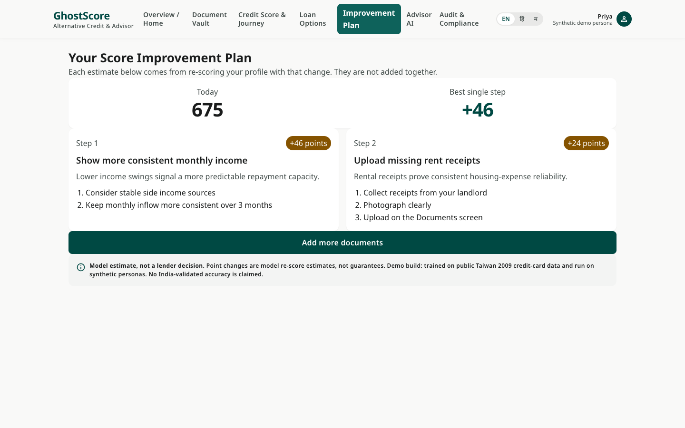
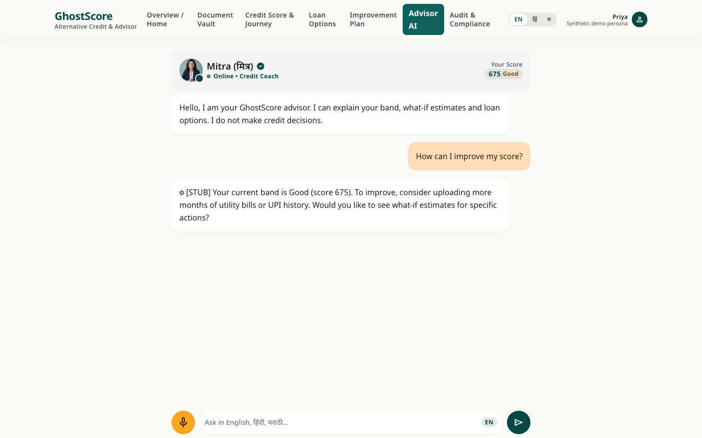
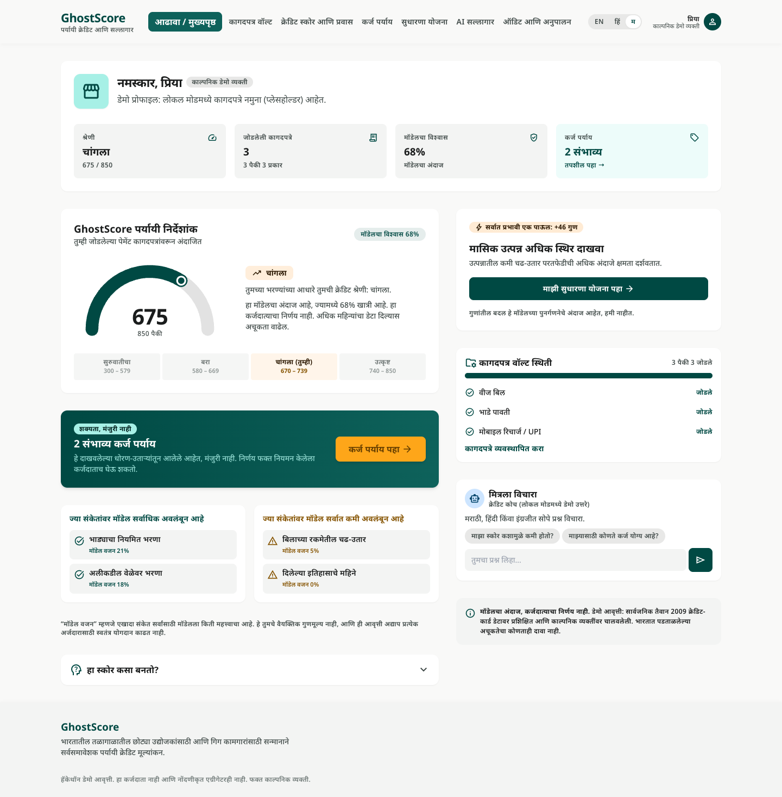
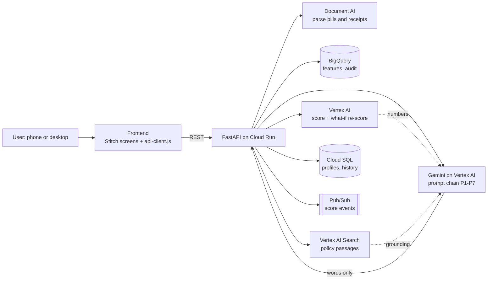

<div align="center">

# 👻 GhostScore

### Your payments tell your story.

**An explainable, alternative credit-scoring prototype for India's credit-invisible population,**
**built on Google Cloud for the *BFSI: Intelligent Risk, Fraud & Financial Experiences* hackathon track.**




<sub>Desktop dashboard in local stub mode. Priya is a <b>synthetic</b> persona; every number comes from the demo model.</sub>

</div>

---

## Contents

[The problem](#-the-problem) · [What it does](#-what-it-does) · [Screens](#-screens) · [Architecture](#-architecture) · [Google Cloud services](#-google-cloud-services-88-in-the-design) · [Quick start](#-quick-start-local-no-gcp-needed) · [Docker and Cloud Run](#-docker-and-cloud-run) · [Demo walkthrough](#-demo-walkthrough-priya) · [API](#-api) · [Tests](#-tests) · [Layouts and languages](#-layouts-and-languages) · [Honest limitations](#-honest-limitations) · [Stubbed vs real](#-what-is-stubbed-vs-real) · [Project structure](#-project-structure) · [Data sources](#-data-sources-consulted)

---

## 🎯 The problem

Hundreds of millions of people in India pay rent, electricity and mobile bills on time every month, yet have no credit-bureau file. To a traditional lender they are invisible. GhostScore asks: **can everyday payment regularity be turned into a fair, explainable credit band, and can the person be told in their own language what to do next?**

## ✨ What it does

| | Feature | How |
|---|---|---|
| 📄 | **Reads payment documents** | Electricity bill, rent receipt, mobile recharge / UPI statement go through a Document AI step (stubbed locally). |
| 🔍 | **Intake check** | A verifier prompt (P1) flags unreadable or inconsistent fields before scoring. |
| 📊 | **Scores with a real model** | A scikit-learn gradient-boosting pipeline gives a 300-850 score and a band: Building, Fair, Good, Excellent. |
| 🧠 | **Explains in plain words** | Top signals the model leans on most and least, in everyday language. |
| 🔮 | **Improvement plan with honest "+X points"** | Each step is re-scored by the model (a what-if). **Gemini never computes numbers.** |
| 🏦 | **Loan options, not approvals** | Products matched against policy passages (RBI / PMMY style). Only a regulated lender can decide. |
| 💬 | **Advisor chat ("Mitra")** | Ask "What lowers my score?" in English, Hindi or Marathi. |
| 🌐 | **Three languages** | EN / हिं / म across the UI and generated text. Numbers and IDs are never translated. |
| 🧾 | **Audit view** | A judges' view of the audit log. |
| 📱🖥️ | **Phone and desktop layouts** | Switches automatically at 1280px. |

> **Design rule:** the language model writes words, the scoring model produces numbers. In local mode a test checks that the plan's "+N points" figures equal the what-if re-score deltas. Gemini itself has not been run, so the same rule is enforced only by the P3/P5 prompts in GCP mode.

## 🖼️ Screens

<table>
  <tr>
    <td align="center"><br><sub>Consent and data-rights start page</sub></td>
    <td align="center"><br><sub>Loan options (possibilities, not approvals)</sub></td>
  </tr>
  <tr>
    <td align="center"><br><sub>Improvement plan with what-if re-scores</sub></td>
    <td align="center"><br><sub>Advisor chat</sub></td>
  </tr>
  <tr>
    <td align="center"><br><sub>Hindi (AI-drafted, not native-reviewed)</sub></td>
    <td align="center"><br><sub>Marathi (AI-drafted, not native-reviewed)</sub></td>
  </tr>
</table>

## 🏗️ Architecture



**Prompt chain**

| Step | Purpose |
|---|---|
| P1 | Intake verifier: flags document problems |
| P2 | Score explainer: turns model signals into plain language |
| P3 | Improvement planner: wraps the Vertex AI what-if deltas |
| P4 | Loan matcher: grounded in retrieved policy passages |
| P5 | Compliance reviewer: checks numbers against source data, no approval promises, no protected attributes. **The local stub always passes**; the real check exists only as a Gemini prompt that has not been run. |
| P6 | Advisor chat |
| P7 | Localizer: Hindi and Marathi |

## ☁️ Google Cloud services (8/8 in the design)

| Service | Role | Status in this repo |
|---|---|---|
| **Gemini on Vertex AI** | Prompt chain P1-P7 | ⚙ Stubbed locally. GCP code written, never run. |
| **Vertex AI** | Credit band prediction and what-if re-scores | ⚙ Stubbed locally (sklearn model stands in). |
| **BigQuery** | Feature SQL, feature store, audit log | SQL in [`sql/`](sql/). Not executed. |
| **Document AI** | Parse bills, receipts, statements | ⚙ Stubbed locally. |
| **Vertex AI Search** | Policy and loan-product retrieval | ⚙ Stubbed locally (5 hardcoded passages). |
| **Cloud Run** | API and frontend hosting | [`Dockerfile`](Dockerfile) and [`infra/deploy.sh`](infra/deploy.sh) ready. See [deploy](#-docker-and-cloud-run). |
| **Cloud SQL** | Profiles, score history | In-memory locally. |
| **Pub/Sub** | Score events for continuous scoring | ⚙ Stubbed locally (console log). |

Local mode prints `⚙ STUB` for every simulated call. **Nothing in this repo has been verified against live Google Cloud services.**

## 🚀 Quick start (local, no GCP needed)

```bash
cd ghostscore/
python3 -m venv .venv && source .venv/bin/activate
pip install -r backend/requirements.txt

python ml/train.py                  # optional: model.joblib is already committed
python data/personas/generate.py    # optional: synthetic personas

GHOSTSCORE_MODE=local uvicorn main:app --app-dir backend --port 8000 --reload
```

| URL | What |
|---|---|
| <http://localhost:8000/> | Redirects to the app's welcome screen |
| <http://localhost:8000/docs> | Interactive API docs |
| <http://localhost:8000/health> | `{"status":"ok","mode":"local"}` |

## 🐳 Docker and Cloud Run

The root [`Dockerfile`](Dockerfile) packages `backend/`, `frontend/` and `ml/artifacts/` and runs in **local stub mode** by default, so a deployment needs no extra Google Cloud setup.

**Run the container locally** (needs Docker):

```bash
docker build -t ghostscore .
docker run --rm -p 8080:8080 ghostscore
# open http://localhost:8080/
```

**Deploy to Cloud Run** (run in [Cloud Shell](https://shell.cloud.google.com), which has `gcloud` and Cloud Build, so no local Docker is needed):

```bash
git clone https://github.com/Deeptesha/GhostScore.git && cd GhostScore
gcloud config set project YOUR_PROJECT_ID
gcloud services enable run.googleapis.com cloudbuild.googleapis.com artifactregistry.googleapis.com

GCP_PROJECT=YOUR_PROJECT_ID bash infra/deploy.sh
```

The script builds with Cloud Build (`gcloud run deploy --source .`), deploys service `ghostscore` to `us-central1`, and prints the URL. Open `<URL>/` for the app and `<URL>/health` to check.

> ⚠️ A deployment made this way is a **stub-mode demo**: the model is real, but Document AI, Gemini, Vertex AI Search, Pub/Sub and Cloud SQL are simulated, and data resets when an instance restarts.
>
> `GHOSTSCORE_MODE=gcp` exists in the code but **has never been run**. If you try it, run `infra/setup_gcp.sh` first and expect to debug. Manual steps are listed in that script.

## 🎬 Demo walkthrough (Priya)

Priya is a **synthetic** persona (a tea stall operator) with no bureau file.

1. Open the welcome screen and read the data-rights promise. Choose which data to link.
2. **Upload** an electricity bill, rent receipt and mobile recharge. Local mode accepts any file and returns synthetic fields.
3. **Review** the intake check from P1.
4. **Calculate my score.** With all three documents Priya gets **675 (Good), model confidence 68%**.
5. Open the **Improvement plan.** The best single step is worth about **+46 points**, from a model re-score, not from Gemini.
6. See **Loan options.** Two possibilities, grounded in policy passages and clearly not approvals.
7. Ask **Mitra** "What lowers my score?" and switch to हिं or म.
8. Open the **Audit** view (judges' view of the audit log).

A narrated 3-minute script is in [`docs/DEMO_SCRIPT.md`](docs/DEMO_SCRIPT.md) and the submission deck is [`docs/GhostScore_Submission.pptx`](docs/GhostScore_Submission.pptx). The script still describes the phone UI.

## 🔌 API

| Method | Path | Description | Prompt step |
|---|---|---|---|
| `POST` | `/documents` | Upload a document, run Document AI | none |
| `GET`  | `/documents/{id}/review` | Intake verification | P1 |
| `POST` | `/score` | Compute score and band | P2 + P5 |
| `GET`  | `/score/latest` | Latest score for a user | P2 + P5 |
| `GET`  | `/plan` | Improvement plan | P3 + P5 |
| `GET`  | `/options` | Loan product matching | P4 + P5 |
| `POST` | `/chat` | Conversational advisor | P6 + P7 |
| `GET`  | `/history` | Score history | none |
| `GET`  | `/audit` | Audit log (judges view) | none |
| `GET`  | `/health` | Liveness and mode | none |

`?language=en|hi|mr` localises the generated text of `/score`, `/score/latest`, `/plan`, `/options`, `/chat` and the document review message.

```bash
# Upload, then score
curl -X POST localhost:8000/documents -F "file=@any_file.pdf" -F doc_type=electricity_bill -F user_id=priya
curl -X POST localhost:8000/score -H "Content-Type: application/json" \
  -d '{"user_id":"priya","doc_ids":["<DOC_ID>"],"language":"en"}'
curl "localhost:8000/plan?user_id=priya"
curl -X POST localhost:8000/chat -H "Content-Type: application/json" \
  -d '{"user_id":"priya","message":"What is my score?","language":"en"}'
```

## 🧪 Tests

```bash
GHOSTSCORE_MODE=local PYTHONPATH=backend .venv/bin/python -m pytest tests/ -v
```

**28 tests** cover every endpoint, the check that plan figures come from the what-if re-score, the Priya end-to-end flow, and Hindi/Marathi localisation (numbers and IDs unchanged). They run against local stubs only.

Browser tests (real Chrome via Playwright; start the server first on port 8000 in local mode):

```bash
.venv/bin/python tests/e2e_ui.py        # English click-through of the Priya flow
.venv/bin/python tests/e2e_lang.py      # EN -> हिं -> म on every screen
.venv/bin/python tests/e2e_desktop.py   # 1440px layout: live data, no sample claims, mobile redirect
```

## 📱 Layouts and languages

**Layouts**

- Phone layout covers all 9 screens. Two screens also have Stitch desktop designs: the score dashboard and loan options.
- Windows 1280px wide or more get the desktop pages for those two. Narrower windows get the phone pages.
- Other screens (welcome, upload, review, plan, chat, history, audit) have no Stitch desktop design. On a wide window `api-client.js` (`desktopShell`) swaps in the desktop header and widens the content. This is a layout adaptation, not a separate design.
- The Stitch desktop export contained sample content this build cannot back up (a sample merchant's revenue, named bank/NBFC offers, "Certified Partner", an LSP registry number, Account Aggregator refresh, invented score weights, a PDF passbook, "Share with Lenders", loan filters). These were removed or replaced with live API data.

**Languages**

- The EN / हिं / म switch changes screen text, generated explanations and date formats. Score numbers, point estimates and IDs are never translated or recomputed.
- In **local mode** generated text comes from a fixed table (`backend/app/i18n.py`) covering stub outputs only. Any string not in the table stays in English. In **GCP mode** the P7 prompt would translate with Gemini; that path has not been run.
- **The Hindi and Marathi wording was drafted by an AI assistant and has not been reviewed by a native speaker.** Have it reviewed before showing it to users.
- Not translated: values read from a document (names, biller, months), text the user types, and `/audit` identifiers.

## ⚠️ Honest limitations

### Data
- **No India-specific training data.** The model is trained on *UCI Default of Credit Card Clients* (Taiwan, 2009, 30,000 rows): credit-card data, not Indian UPI, utility or rent data. **No India-specific accuracy is claimed.**
- **The feature mapping is an assumption.** Mapping UCI columns to GhostScore features (payment_consistency, rental_reliability, ...) is documented in `ml/train.py` and has not been validated.
- **Personas are synthetic.** Priya, Raju and Seema are calibrated against NPCI UPI statistics but are not real people. Do not use them as training data.
- **Home Credit and Xente datasets were not downloaded.** They require accepted Kaggle/Zindi terms. A mapping template is in `ml/train.py`.

### Production
- **Account Aggregator is a proposed production path, not built.** A real deployment needs a regulated lending partner and customer consent. Bank statements show payment regularity, not punctuality, because there are no due dates.
- **Transaction classification is uncertain.** Inferring rent or utility payments from bank descriptions is unreliable without validated data.
- **GhostScore is not a lender, not a registered aggregator, and holds no certifications.** It produces model estimates, never approvals.

### Model
- **Test AUC 0.77** on a held-out 20% of the UCI data. Reported for transparency only; it says nothing about Indian credit risk or about the signals GhostScore is designed to use.
- **"Model weight"** on the dashboard is how much a signal matters to the model overall. It is not a personal point value; per-applicant attribution is not computed.
- **Fairness metrics are not computed.** Vertex AI fairness monitoring is in the design but not implemented.
- **Latency** (local mode, stub Gemini, 40 calls): `/score` median 4.3 ms, `/plan` 23.3 ms, `/options` 0.8 ms. These exclude any real Google Cloud call.

## 🔍 What is stubbed vs real

| Component | Local (`MODE=local`) | GCP (`MODE=gcp`, never run) |
|---|---|---|
| Document parsing | Deterministic stub returns synthetic fields | Document AI |
| Credit scoring | **Real** sklearn GBM trained on UCI | Vertex AI endpoint |
| What-if re-score | **Real** (same model) | Vertex AI endpoint |
| Gemini chain (P1-P7) | Deterministic stubs | Gemini on Vertex AI |
| Policy retrieval | 5 hardcoded passages | Vertex AI Search |
| Pub/Sub | Console log | Pub/Sub |
| Cloud SQL | In-memory dict | Cloud SQL |

## 🗂️ Project structure

```
ghostscore/
├── Dockerfile                    # Cloud Run / container image (local stub mode by default)
├── .dockerignore
├── backend/
│   ├── main.py                   # FastAPI entry point, serves /ui and redirects /
│   ├── requirements.txt
│   └── app/
│       ├── config.py             # MODE=local|gcp and env vars
│       ├── i18n.py               # EN/HI/MR localisation table (local mode)
│       ├── models/               # Pydantic request/response models
│       ├── api/                  # Route handlers
│       ├── gemini/               # Prompt chain P1-P7
│       └── gcp/                  # GCP client interfaces with local stubs
├── frontend/
│   ├── api-client.js             # Wires Stitch screens to the API; i18n; desktop layout logic
│   └── stitch/                   # Stitch export: phone screens + 2 desktop screens
├── ml/
│   ├── train.py                  # Train on UCI; feature mapping
│   └── artifacts/                # model.joblib, feature_names.json
├── sql/                          # BigQuery schema and feature SQL
├── data/personas/                # Synthetic personas (Priya, Raju, Seema)
├── infra/
│   ├── setup_gcp.sh              # Provision GCP resources (never run)
│   └── deploy.sh                 # Cloud Run deploy via Cloud Build
├── tests/
│   ├── test_api.py               # 28 pytest tests
│   └── e2e_ui.py, e2e_lang.py, e2e_desktop.py   # Playwright browser tests
└── docs/
    ├── GhostScore_Submission.pptx
    ├── DEMO_SCRIPT.md
    └── screenshots/
```

## 📚 Data sources consulted

- NPCI UPI Monthly Product Statistics (persona calibration only)
- UCI *Default of Credit Card Clients*, CC BY 4.0 (baseline model training)
- RBI microfinance and PMMY guidelines (policy stub passages)

---

<div align="center"><sub>Hackathon demo build. Synthetic personas only. Not a lender, not a registered aggregator.
